<div align="center">


# IMXX
### `< Software Engineer />`

**Think. Code. Innovate. Experience.**

[](https://github.com/imamihsani)
[](https://github.com/imamihsani)

</div>

---

## About Me

```javascript
const developer = {
    name: "IMXX",
    role: "Software Engineer",
    github: "imamihsani",
    interests: [
        "Software Development",
        "Web Development",
        "System Engineering",
        "Automation",
        "UI/UX Design"
    ],
    motto: "Think. Code. Innovate. Experience."
};

console.log("Welcome to my GitHub!");
```
Passionate about building digital solutions, developing web applications, designing system architectures, and exploring innovative technologies.

I enjoy solving problems, learning new technologies, and transforming ideas into functional digital experiences.

---

## Tech Stack & Skills

### Programming Languages


### Frameworks & Libraries


### Database & Infrastructure


### Design & Other Skills


---

## Featured Projects

| No. | Project | Description |
|:---:|---|---|
| 01 | **Kulotrav** | Travel & Tourism Landing Page |
| 02 | **Face Recognition System** | Facial Recognition & Identification System |
| 03 | **RSUModul** | Electronic Medical Record (ERM) System |
| 04 | **Nearest Route Determination System** | Route Optimization & Determination System |
| 05 | **POS System** | Point of Sale Management System |
| 06 | **MIS (ERP System)** | Management Information System & Enterprise Resource Planning |

---

## GitHub Analytics

<p align="center">
  
  
</p>


### GitHub Streak


---

## Developer Mindset

```text
╔══════════════════════════════════════════╗
║                                          ║
║            THINK BEFORE CODE             ║
║                                          ║
║            CODE TO SOLVE                 ║
║                                          ║
║            INNOVATE WITHOUT LIMITS       ║
║                                          ║
║            EXPERIENCE THE FUTURE         ║
║                                          ║
╚══════════════════════════════════════════╝
```

> "Technology is not just about writing code. It's about creating solutions that make a difference."

---

## Connect With Me

[](https://github.com/imamihsani)

**Explore my repositories and let's build something extraordinary.**

---

**`SYSTEM STATUS: ONLINE`**

**`IMXX // SOFTWARE ENGINEER`**
